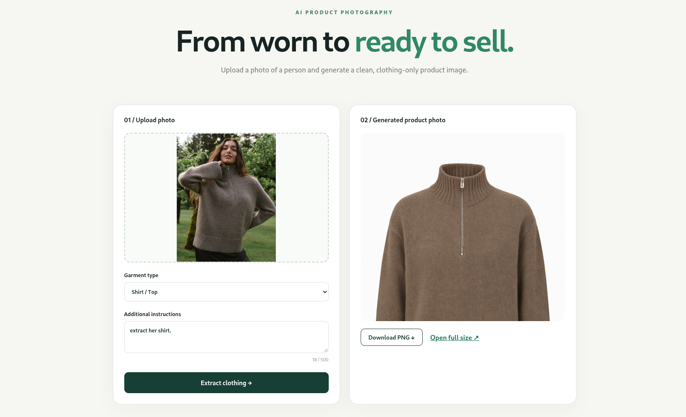

# SAB – AI Clothing Studio

Upload a photo of a person, pick a garment type, and get a clean, clothing-only
product image generated by an image model on [OpenRouter](https://openrouter.ai).



| Part       | Stack                                                       |
| ---------- | ----------------------------------------------------------- |
| `frontend` | SvelteKit 3 + Svelte 5 (runes), Vite 8, TypeScript          |
| `backend`  | FastAPI, async SQLAlchemy + asyncpg, Alembic, Pillow, httpx |
| database   | PostgreSQL 17                                               |

## Run everything with Docker

```sh
cp .env.example .env        # then set OPENROUTER_API_KEY (and a DB password)
docker compose up --build
```

- App: http://localhost:5173 (or `FRONTEND_PORT`)
- API docs: http://localhost:8000/docs (or `BACKEND_PORT`)
- Health: http://localhost:8000/api/v1/health — reports `ai_configured: false`
  until a real API key is set; extraction then returns a clear 503.

If a port is already taken on your machine, change `DB_PORT`, `BACKEND_PORT`
or `FRONTEND_PORT` in `.env`. CORS and the frontend's API URL follow automatically.

Migrations run automatically when the backend container starts.

## Run without Docker (for development)

Start only the database: `docker compose up -d db` (it listens on `127.0.0.1:${DB_PORT}`).

Backend (needs [uv](https://docs.astral.sh/uv/)):

```sh
cd backend
cp .env.example .env        # point DATABASE_URL at localhost:${DB_PORT}
uv sync
uv run alembic upgrade head
uv run uvicorn backend.main:app --reload
```

Frontend (Node ≥ 22.17):

```sh
cd frontend
npm install
PUBLIC_API_URL=http://localhost:8000 npm run dev
npm run check               # type-check
```

## API

| Method | Path                     | Description                                                    |
| ------ | ------------------------ | -------------------------------------------------------------- |
| GET    | `/api/v1/health`         | DB connectivity and whether AI generation is configured        |
| POST   | `/api/v1/images/extract` | multipart: `file`, `garment`, optional `instruction` (≤ 500)   |
| GET    | `/api/v1/images/{id}`    | Status of a job (`processing` / `completed` / `failed` + error) |
| GET    | `/uploads/{name}`        | Stored input (`-input.jpg`) and generated (`-output.png`) images |

`garment` is one of `shirt`, `jacket`, `dress`, `pants`, `skirt`, `shoes`, `other`.
Uploads are limited to 10 MB / 20 MP, are auto-rotated using EXIF data, and are
re-encoded (which strips metadata such as GPS location) before being sent to the model.

## Configuration (backend)

| Variable                     | Default                         |
| ---------------------------- | ------------------------------- |
| `DATABASE_URL`               | — (required)                    |
| `OPENROUTER_API_KEY`         | empty → generation disabled     |
| `OPENROUTER_MODEL`           | `google/gemini-2.5-flash-image` |
| `OPENROUTER_IMAGE_QUALITY`   | empty (not sent); `low`/`medium`/`high` for OpenAI gpt-image models |
| `OPENROUTER_BASE_URL`        | `https://openrouter.ai/api/v1`  |
| `OPENROUTER_TIMEOUT_SECONDS` | `120`                           |
| `CORS_ORIGINS`               | `http://localhost:5173,http://127.0.0.1:5173` |
| `UPLOAD_DIR`                 | `uploads`                       |
